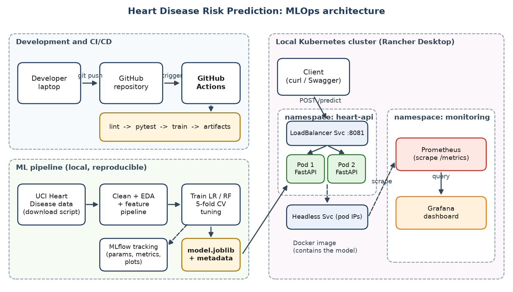

# Heart Disease Risk Prediction — End-to-End MLOps Pipeline

A complete MLOps workflow around the UCI Heart Disease (Cleveland) dataset: data acquisition and
cleaning, experiment tracking with **MLflow**, model packaging, a **FastAPI** inference service,
**Docker** containerisation, **Kubernetes** deployment, **Prometheus/Grafana** monitoring and a
**GitHub Actions** CI pipeline.

```
raw data ─► preprocess ─► train (MLflow) ─► package model ─► FastAPI ─► Docker ─► Kubernetes
                                                                 │                    │
                                                          /metrics + JSON logs ─► Prometheus ─► Grafana
```



## Table of contents

1. [Project structure](#project-structure)
2. [Report and recording](#report-and-recording)
3. [Prerequisites](#prerequisites)
4. [Setup](#setup)
5. [Data pipeline](#data-pipeline)
6. [Training and MLflow tracking](#training-and-mlflow-tracking)
7. [Model packaging and inference](#model-packaging-and-inference)
8. [Testing and linting](#testing-and-linting)
9. [Run the API locally](#run-the-api-locally)
10. [Docker](#docker)
11. [Kubernetes deployment](#kubernetes-deployment)
12. [Monitoring (Prometheus and Grafana)](#monitoring-prometheus-and-grafana)
13. [CI pipeline](#ci-pipeline)
14. [API reference](#api-reference)
15. [Model results](#model-results)
16. [Troubleshooting](#troubleshooting)

---

## Project structure

```
.
├── .github/workflows/ci.yml   # lint → test → train pipeline
├── data/
│   ├── raw/heart_raw.csv          # downloaded dataset
│   ├── processed/heart_clean.csv  # cleaned dataset
│   └── sample_input.json          # example patient record
├── k8s/                       # API manifests (namespace, deployment, services)
├── monitoring/                # Prometheus, Grafana, dashboard.json
├── models/
│   ├── model.joblib               # model served by the API
│   ├── model_metadata.json        # metrics, params, features, versions
│   └── mlflow_model/              # MLflow-format copy of the model
├── notebooks/01_eda.ipynb     # exploratory data analysis
├── recordings/                # screen recording of the end-to-end walkthrough
├── reports/                   # figures, model_comparison.csv, report.md, Word write-up
├── scripts/generate_traffic.py    # load generator for the dashboards
├── screenshots/               # evidence of CI, MLflow, K8s and Grafana runs
├── src/
│   ├── download_data.py           # fetch dataset from UCI
│   ├── preprocess.py              # clean and binarise target
│   ├── features.py                # feature definitions and sklearn pipeline
│   ├── train.py                   # grid search + MLflow tracking
│   ├── package_model.py           # metadata + MLflow model + round-trip check
│   ├── predict.py                 # inference helper / CLI
│   └── app.py                     # FastAPI service
├── tests/                     # pytest suite
├── Dockerfile
├── requirements.txt           # training / full dependencies
├── requirements-api.txt       # slim runtime dependencies for the image
└── requirements-dev.txt       # + flake8, pytest, jupyter
```

## Report and recording

- **Assignment report:** [reports/MLOps_Assignment1_Report.pdf](reports/MLOps_Assignment1_Report.pdf)
  — the full write-up submitted for this assignment, covering the problem statement, pipeline
  design, experiment results and deployment/monitoring evidence. Click through to view it in
  GitHub's built-in PDF viewer (README markdown can't embed an inline viewer directly).
- **Walkthrough recording:** [recordings/Assignment_walkthorugh.mov](recordings/Assignment_walkthorugh.mov)
  — a screen recording demonstrating the end-to-end pipeline (training, API, Docker, Kubernetes
  deployment and Grafana/Prometheus monitoring). Stored via Git LFS; if cloning is slow, download
  it directly from the GitHub file page instead.

  <video src="https://github.com/aezakmi007/heart-disease-mlops-assignment/raw/main/recordings/Assignment_walkthorugh.mov" controls muted width="720">
  Your browser does not support inline video playback. <a href="recordings/Assignment_walkthorugh.mov">Download the recording</a> instead.
  </video>

## Prerequisites

| Tool | Version / notes |
|---|---|
| Python | 3.11 (see `.tools-versions`) |
| Docker | Docker Desktop or any Docker engine |
| kubectl | matching your cluster |
| Kubernetes cluster | Docker Desktop Kubernetes, minikube or kind |

## Setup

```bash
git clone <your-repo-url>
cd mlops-assignment

python3.11 -m venv .venv
source .venv/bin/activate            # Windows: .venv\Scripts\activate

pip install --upgrade pip
pip install -r requirements-dev.txt  # includes requirements.txt + pytest, flake8, jupyter
```

## Data pipeline

```bash
# 1. Download the raw Cleveland dataset  → data/raw/heart_raw.csv
python src/download_data.py

# 2. Clean it (impute ca/thal with mode, drop duplicates, binarise target)
#    → data/processed/heart_clean.csv
python src/preprocess.py
```

Encoding and scaling are part of the scikit-learn pipeline in `src/features.py`, so training and
inference use identical transformations.

Explore the data in [notebooks/01_eda.ipynb](notebooks/01_eda.ipynb):

```bash
jupyter notebook notebooks/01_eda.ipynb
```

## Training and MLflow tracking

`src/train.py` runs a cross-validated grid search for **Logistic Regression** and
**Random Forest**. Each model and each hyper-parameter candidate is logged to MLflow. The tracking
backend is SQLite (`mlflow.db` in the project root).

```bash
# Train, tune, evaluate and log everything to MLflow
python src/train.py
```

What gets logged per run: parameters, CV ROC-AUC, test accuracy/precision/recall/F1/ROC-AUC,
confusion-matrix and ROC plots, the fitted sklearn pipeline, and a `selected_as_best` tag on the
winning model. The comparison table is written to `reports/model_comparison.csv`.

### Open the MLflow UI

```bash
# Run from the project root so it finds mlflow.db
mlflow ui --backend-store-uri sqlite:///mlflow.db --port 5000
```

Then open <http://localhost:5000> and select the `heart-disease-classification` experiment to
compare runs, inspect plots and download artifacts.

Useful MLflow CLI commands:

```bash
# List experiments
mlflow experiments search --view all

# Search runs (set MLFLOW_TRACKING_URI so the CLI uses the SQLite store)
export MLFLOW_TRACKING_URI=sqlite:///mlflow.db
mlflow runs list --experiment-id 1

# Serve the packaged MLflow model as a REST endpoint (optional alternative to FastAPI)
mlflow models serve -m models/mlflow_model --port 5001 --env-manager local
```

Test the MLflow-served model:

```bash
curl -X POST http://localhost:5001/invocations \
  -H "Content-Type: application/json" \
  --data @models/mlflow_model/serving_input_example.json
```

> `mlruns/` and `mlflow.db` are local tracking state and are git-ignored. Do not commit them. A
> symlinked or missing `mlruns/` breaks training in CI.

## Model packaging and inference

```bash
# Writes models/model.joblib, models/model_metadata.json and models/mlflow_model/,
# then verifies the saved model reproduces its predictions.
python src/package_model.py

# CLI prediction on the sample record (or pass your own JSON file)
python src/predict.py
python src/predict.py data/sample_input.json
```

Example output:

```json
{
  "prediction": 1,
  "label": "disease",
  "confidence": 0.93,
  "probability_disease": 0.93
}
```

## Testing and linting

```bash
# Unit + API tests (pytest.ini sets pythonpath=src)
pytest

# With a JUnit report, as in CI
pytest --junitxml=pytest-report.xml

# Lint (config in .flake8, max line length 100)
flake8 src tests --count --statistics
```

## Run the API locally

```bash
uvicorn app:app --app-dir src --host 0.0.0.0 --port 8001 --reload
```

- Swagger UI: <http://localhost:8001/docs>
- Health: <http://localhost:8001/health>
- Metrics: <http://localhost:8001/metrics>

```bash
curl http://localhost:8001/health

curl -X POST http://localhost:8001/predict \
  -H "Content-Type: application/json" \
  -d @data/sample_input.json
```

## Docker

The image is based on `python:3.11-slim`, installs only `requirements-api.txt`, copies the API code
and `models/model.joblib`, runs as a non-root user and exposes port **8001** with a health check.

### Build

```bash
# Make sure models/model.joblib exists first (python src/train.py && python src/package_model.py)
docker build -t heart-disease-api:2.0 .
```

### Run

```bash
docker run -d --name heart-api -p 8001:8001 heart-disease-api:2.0

# Verify
docker ps
docker logs -f heart-api
curl http://localhost:8001/health
curl -X POST http://localhost:8001/predict \
  -H "Content-Type: application/json" -d @data/sample_input.json

# Stop and clean up
docker stop heart-api && docker rm heart-api
```

### Inspect and publish (optional)

```bash
docker images heart-disease-api
docker inspect --format='{{.State.Health.Status}}' heart-api

# Push to a registry (replace <registry>/<user>)
docker tag heart-disease-api:2.0 <registry>/<user>/heart-disease-api:2.0
docker push <registry>/<user>/heart-disease-api:2.0
```

If you push to a registry, update `image:` in [k8s/10-deployment.yaml](k8s/10-deployment.yaml)
(and `imagePullPolicy` if needed).

## Kubernetes deployment

Manifests in `k8s/` (applied in filename order):

| File | Resource |
|---|---|
| `00-namespace.yaml` | Namespace `heart-api` |
| `10-deployment.yaml` | Deployment, 2 replicas, rolling update, probes, resource limits, non-root |
| `20-service.yaml` | `LoadBalancer` Service, port **8081** → container port 8001 |
| `30-service-headless.yaml` | Headless Service, used by Prometheus to discover every pod |

### 1. Make the image available to the cluster

The deployment uses `heart-disease-api:2.0` with `imagePullPolicy: IfNotPresent`, so the image must
be present on the cluster nodes.

```bash
# Docker Desktop Kubernetes: shares the local Docker daemon, no extra step needed.

# minikube
minikube start
minikube image load heart-disease-api:2.0
#   or build straight into minikube's daemon:
#   eval $(minikube docker-env) && docker build -t heart-disease-api:2.0 .

# kind
kind create cluster
kind load docker-image heart-disease-api:2.0
```

### 2. Deploy

```bash
kubectl config current-context              # confirm the target cluster

kubectl apply -f k8s/                       # applies all four manifests in order
kubectl rollout status deployment/heart-api -n heart-api
```

### 3. Verify

```bash
kubectl get all -n heart-api
kubectl get pods -n heart-api -o wide
kubectl describe deployment heart-api -n heart-api
kubectl get endpoints -n heart-api
```

### 4. Access the service

```bash
# Docker Desktop: the LoadBalancer is exposed on localhost
curl http://localhost:8081/health

# Any cluster: port-forward the service
kubectl port-forward svc/heart-api 8081:8081 -n heart-api

# minikube: open a tunnel (separate terminal) or ask for the URL
minikube tunnel
minikube service heart-api -n heart-api --url
```

```bash
curl -X POST http://localhost:8081/predict \
  -H "Content-Type: application/json" \
  -d @data/sample_input.json
```

Swagger UI is at <http://localhost:8081/docs>.

### 5. Logs and debugging

```bash
kubectl logs -f deployment/heart-api -n heart-api
kubectl logs -l app=heart-api -n heart-api --tail=50 --prefix
kubectl describe pod -l app=heart-api -n heart-api
kubectl get events -n heart-api --sort-by=.lastTimestamp
kubectl exec -it deploy/heart-api -n heart-api -- sh
```

### 6. Scale, update and roll back

```bash
# Scale
kubectl scale deployment/heart-api --replicas=3 -n heart-api

# Rolling update after building a new image tag
docker build -t heart-disease-api:2.1 .
kubectl set image deployment/heart-api api=heart-disease-api:2.1 -n heart-api
kubectl rollout status deployment/heart-api -n heart-api

# History and rollback
kubectl rollout history deployment/heart-api -n heart-api
kubectl rollout undo deployment/heart-api -n heart-api

# Restart pods without changing the spec
kubectl rollout restart deployment/heart-api -n heart-api
```

`maxUnavailable: 0` with `maxSurge: 1` keeps the service available throughout an update.

### 7. Tear down

```bash
kubectl delete -f k8s/
# or
kubectl delete namespace heart-api
```

## Monitoring (Prometheus and Grafana)

The API exposes Prometheus metrics at `/metrics` and logs structured JSON (request id, method,
path, status, latency, prediction and confidence).

| Metric | Type | Description |
|---|---|---|
| `api_requests_total{method,path,status}` | Counter | HTTP requests |
| `api_request_duration_seconds{path}` | Histogram | Request latency |
| `api_predictions_total{label}` | Counter | Predictions by class |
| `api_prediction_confidence` | Histogram | Prediction confidence |

Prometheus discovers every API pod through the headless service
`heart-api-headless.heart-api.svc.cluster.local` (port 8001), so the API must be deployed first.

### Deploy the monitoring stack

```bash
# 1. Namespace
kubectl apply -f monitoring/00-namespace.yaml

# 2. Grafana dashboard ConfigMap (referenced by 20-grafana.yaml, created from the JSON file)
kubectl create configmap grafana-dashboards \
  --from-file=dashboard.json=monitoring/dashboard.json \
  -n monitoring

# 3. Prometheus and Grafana
kubectl apply -f monitoring/10-prometheus.yaml
kubectl apply -f monitoring/20-grafana.yaml

kubectl rollout status deployment/prometheus -n monitoring
kubectl rollout status deployment/grafana -n monitoring
kubectl get all -n monitoring
```

To update the dashboard after editing `dashboard.json`:

```bash
kubectl create configmap grafana-dashboards \
  --from-file=dashboard.json=monitoring/dashboard.json \
  -n monitoring --dry-run=client -o yaml | kubectl apply -f -
kubectl rollout restart deployment/grafana -n monitoring
```

### Access the UIs

```bash
# Prometheus  → http://localhost:9090  (check Status → Targets)
kubectl port-forward svc/prometheus 9090:9090 -n monitoring

# Grafana     → http://localhost:3000  (login: admin / admin123, local demo only)
kubectl port-forward svc/grafana 3000:3000 -n monitoring
```

> The Grafana password is hard-coded in `monitoring/20-grafana.yaml` for local demo purposes. Use
> a Kubernetes Secret for any real deployment.

### Generate traffic for the dashboards

```bash
# Keep the API port-forward running (kubectl port-forward svc/heart-api 8081:8081 -n heart-api)
python scripts/generate_traffic.py --url http://localhost:8081 --n 300 --delay 0.2
```

The script sends realistic random patients plus a few invalid requests so request rate, latency,
error rate, prediction mix and confidence panels all populate.

### Tear down monitoring

```bash
kubectl delete -f monitoring/20-grafana.yaml -f monitoring/10-prometheus.yaml
kubectl delete configmap grafana-dashboards -n monitoring
kubectl delete namespace monitoring
```

## CI pipeline

[.github/workflows/ci.yml](.github/workflows/ci.yml) runs on pushes to `main`/`master`, pull
requests and manual dispatch. Jobs run in sequence:

1. **lint**: `flake8 src tests`, uploads `flake8-report.txt`
2. **test**: `pytest`, uploads `pytest-report.xml`
3. **train**: preprocess → train (MLflow) → package model → smoke-test inference, then uploads
   `models/`, `reports/` and `mlruns/` as the `training-artifacts` artifact

Reproduce the whole pipeline locally:

```bash
flake8 src tests --count --statistics \
  && pytest \
  && python src/preprocess.py \
  && python src/train.py \
  && python src/package_model.py \
  && python src/predict.py
```

## API reference

### `GET /health`

```json
{"status": "ok", "model_loaded": true}
```

### `POST /predict`

Request body (all 13 fields required, validated with Pydantic, invalid input returns `422`):

| Field | Type | Range / values | Meaning |
|---|---|---|---|
| `age` | int | 1–120 | Age in years |
| `sex` | int | 0–1 | 1 = male, 0 = female |
| `cp` | int | 1–4 | Chest pain type |
| `trestbps` | int | 50–260 | Resting blood pressure (mm Hg) |
| `chol` | int | 80–700 | Serum cholesterol (mg/dl) |
| `fbs` | int | 0–1 | Fasting blood sugar > 120 mg/dl |
| `restecg` | int | 0–2 | Resting ECG result |
| `thalach` | int | 50–250 | Max heart rate achieved |
| `exang` | int | 0–1 | Exercise-induced angina |
| `oldpeak` | float | 0–10 | ST depression |
| `slope` | int | 1–3 | Slope of peak exercise ST segment |
| `ca` | int | 0–4 | Major vessels coloured |
| `thal` | int | 3, 6 or 7 | 3 normal, 6 fixed defect, 7 reversible defect |

Response:

```json
{
  "prediction": 1,
  "label": "disease",
  "confidence": 0.93,
  "probability_disease": 0.93
}
```

### `GET /metrics`

Prometheus text exposition format.

## Model results

Held-out test set, selected by cross-validated ROC-AUC (from
[reports/model_comparison.csv](reports/model_comparison.csv)):

| Model | CV ROC-AUC | Accuracy | Precision | Recall | F1 | ROC-AUC |
|---|---|---|---|---|---|---|
| **Logistic Regression** (C=1, l2) | 0.9025 | 0.8852 | 0.8387 | 0.9286 | 0.8814 | 0.9665 |
| Random Forest (depth 4, 100 trees) | 0.9007 | 0.8361 | 0.8214 | 0.8214 | 0.8214 | 0.9437 |

Logistic Regression is the selected model and is the one served by the API. The full write-up is in
[reports/report.md](reports/report.md), and screenshots of CI, MLflow, Kubernetes and Grafana runs
are in [screenshots/](screenshots/).

## Troubleshooting

| Symptom | Fix |
|---|---|
| `ErrImagePull` / `ImagePullBackOff` | The image is not on the cluster. Run `minikube image load heart-disease-api:2.0` or `kind load docker-image heart-disease-api:2.0`, or push to a registry and update the manifest. |
| Pods `Running` but not `Ready` | `kubectl logs` and `kubectl describe pod`. The readiness probe hits `/health` on port 8001. |
| `localhost:8081` not reachable | Use `kubectl port-forward svc/heart-api 8081:8081 -n heart-api`, or `minikube tunnel` on minikube. |
| Prometheus target is down or empty | Deploy the API first, and check `kubectl get endpoints heart-api-headless -n heart-api`. |
| Grafana pod stuck in `ContainerCreating` | The `grafana-dashboards` ConfigMap is missing. Create it with the command in [Monitoring](#deploy-the-monitoring-stack). |
| `FileNotFoundError: .../mlruns/1` during training | `mlruns` must be a real, git-ignored directory, not a committed or dangling symlink. |
| `FileNotFoundError: models/model.joblib` when building the image | Run `python src/train.py` before `docker build`. |
| MLflow UI shows no runs | Start it from the project root with `--backend-store-uri sqlite:///mlflow.db`. |
| `ModuleNotFoundError: features` in tests | Run `pytest` from the project root so `pytest.ini` sets `pythonpath = src`. |
